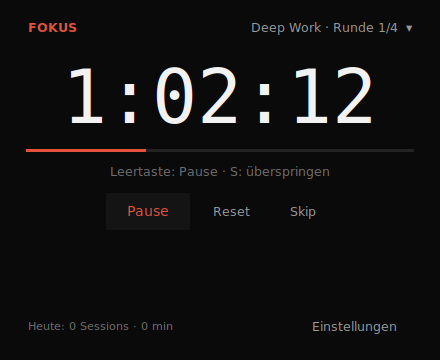
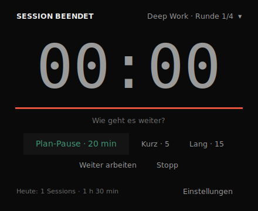
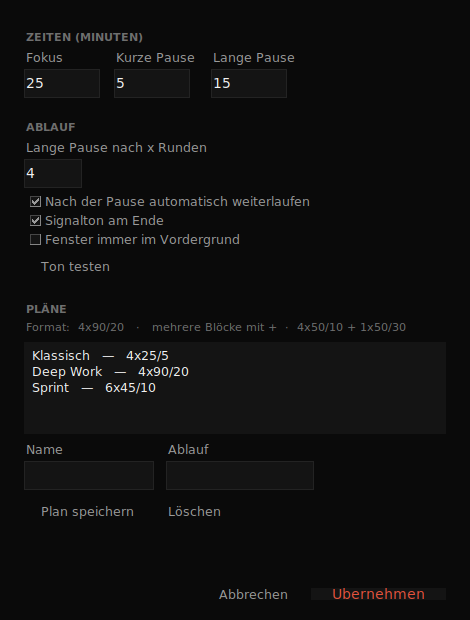

# Pomodoro

Minimalistischer, schwarzer Pomodoro-Timer für Windows. Freie Zeiten, Signalton am
Ende jeder Einheit, nach jeder Session die Auswahl zwischen kurzer und langer Pause
(beide selbst definiert) und vorab planbare Abläufe wie `4x90/20`.



## Starten

**Variante A – mit Python** (empfohlen, echtes Desktop-Fenster)

1. Python von [python.org](https://www.python.org/downloads/) installieren,
   beim Setup **"Add python.exe to PATH"** anhaken.
2. `Pomodoro.bat` doppelklicken.

Es wird nichts nachinstalliert – die App nutzt nur die Python-Standardbibliothek.

**Variante B – eigene .exe**

`build_exe.bat` doppelklicken. Danach liegt unter `dist\Pomodoro.exe` eine einzelne
Datei, die sich frei verschieben lässt (z. B. auf den Desktop) und ohne Python läuft.

**Variante C – ohne Installation**

`pomodoro.html` doppelklicken. Läuft im Browser, gleiche Funktionen, Einstellungen
werden im Browser gespeichert.

## Bedienung

| Taste | Wirkung |
|-------|---------|
| `Leertaste` | Start / Pause |
| `R` | Zurücksetzen |
| `S` | Aktuelle Einheit überspringen |
| `1` / `2` / `3` | Im Auswahlbildschirm: kurze Pause / lange Pause / weiterarbeiten |
| `Esc` | Fenster minimieren |

### Ablauf

Läuft eine Fokus-Einheit ab, ertönt ein Signalton, das Fenster meldet sich in der
Taskleiste und es erscheint die Auswahl:



- **Kurze Pause / Lange Pause** – die beiden Zeiten legst du vorher in den
  Einstellungen fest. Steht dort 10 bei "Kurze Pause", startet ein Klick auf
  "Kurz · 10" genau 10 Minuten.
- **Plan-Pause** – ist ein Plan aktiv, wird dessen Pause als erste Option
  vorgeschlagen; kurz/lang bleiben trotzdem wählbar.
- **Weiter arbeiten** – Pause überspringen, direkt die nächste Fokus-Einheit.
- **Stopp** – Timer anhalten, nichts läuft weiter.

Nach einer Pause geht es automatisch mit dem Fokus weiter (abschaltbar in den
Einstellungen). Ohne aktiven Plan wird nach je 4 Einheiten (einstellbar) die lange
Pause als Hauptoption vorgeschlagen.

### Pläne

Ein Plan ist eine Abfolge von Runden, geschrieben als `Anzahl x Fokus/Pause`:

| Eingabe | Bedeutung |
|---------|-----------|
| `4x90/20` | 4 Runden mit 90 min Fokus und 20 min Pause |
| `4x25/5` | klassischer Pomodoro |
| `4x50/10 + 1x50/30` | 4 kurze Runden, dann eine mit langer Pause |
| `2x1:30/0:30` | 1½ min Fokus, 30 s Pause (zum Ausprobieren) |

Mehrere Blöcke werden mit `+`, `,` oder `;` verkettet. Zeiten gehen als Minuten
(`90`), Dezimalzahl (`1,5`) oder als `Minuten:Sekunden` (`1:30`).

Pläne legst du unter **Einstellungen → Pläne** an; die Vorschau zeigt sofort, wie
lange der Ablauf insgesamt dauert. Über die Anzeige oben rechts im Hauptfenster
wählst du den aktiven Plan aus. Die Kopfzeile zeigt dann die aktuelle Runde
(`Deep Work · Runde 2/4`). Ist der Plan durch, springt der Timer auf den Anfang
zurück.



## Einstellungen

Alle Werte landen in `%APPDATA%\MinimalPomodoro\config.json`:

- **Fokus / Kurze Pause / Lange Pause** – frei einstellbar, von Sekunden bis Stunden
- **Lange Pause nach x Runden** – 0 schaltet den Vorschlag ab
- **Nach der Pause automatisch weiterlaufen**
- **Signalton am Ende** – der Ton wird beim Start selbst erzeugt, es wird keine
  Audiodatei gebraucht
- **Fenster immer im Vordergrund**

## Tests

```
python -m unittest discover -s tests
```

23 Tests für Zeit- und Planparser, Formatierung, Tonerzeugung sowie den kompletten
Ablauf (Plan durchlaufen, Pausenauswahl, Statistik, Einstellungsdialog).
Die GUI-Tests werden übersprungen, wenn kein Bildschirm verfügbar ist.
