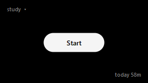
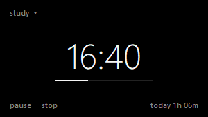
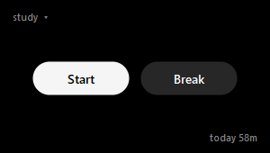
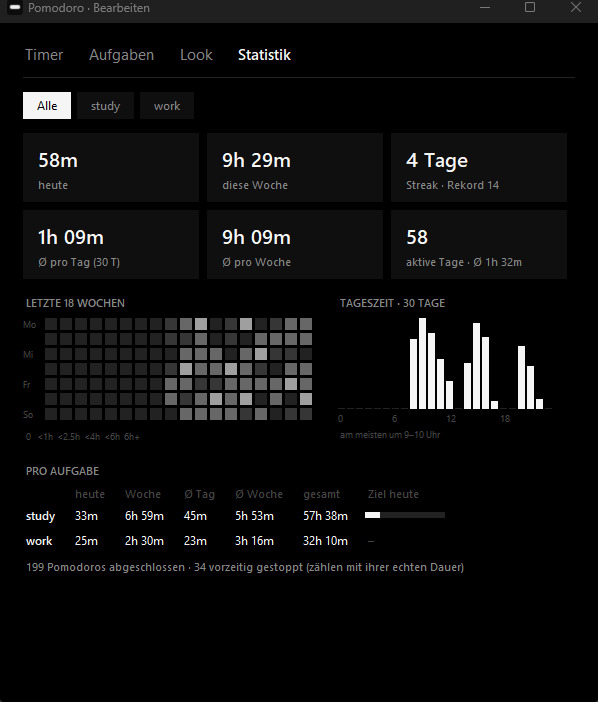
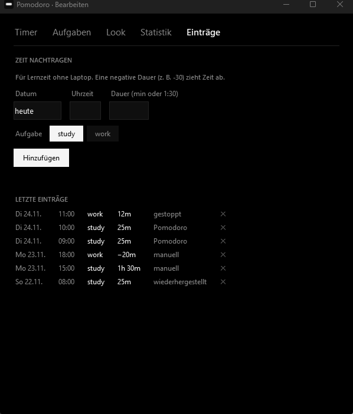

# Pomodoro

Minimaler Pomodoro-Timer für Windows: ein kleines schwarzes Widget ohne Rahmen, in der
Mitte nur **Start**. Alles andere steckt im Bearbeitungsmodus (Rechtsklick).
Reines Python (Standardbibliothek + Tkinter), nichts nachzuinstallieren.

  

## Einrichten

1. Python von [python.org](https://www.python.org/downloads/) installieren
   (beim Setup „Add python.exe to PATH“ und „tcl/tk and IDLE“ anhaken).
2. Einmal ausführen:

   ```
   pythonw pomodoro.py --install
   ```

   Das legt eine Verknüpfung **Pomodoro** auf dem Desktop und im Startmenü an
   (im Startmenü rechtsklicken → „An Taskleiste anheften“) und startet den Timer
   automatisch bei der Windows-Anmeldung. Rückgängig: `pythonw pomodoro.py --uninstall`.
   Autostart lässt sich auch unter *Bearbeiten → Timer* an- und ausschalten.

## Bedienung

| Aktion | So geht's |
|---|---|
| Pomodoro starten | **Start** klicken oder Leertaste |
| Pause / weiter | Klick auf die Zeit oder Leertaste |
| Stoppen | Maus übers Widget → *stop* (zählt mit der echten Dauer, ab 1 min) |
| Nach dem Pomodoro | **Start** (weiterlernen) oder **Break** → *Short* / *Long* |
| Aufgabe wechseln | Klick oben links (z. B. `study ▾`) |
| Verschieben | Widget ziehen |
| Bearbeiten, Statistik, Zeit nachtragen | Rechtsklick |

Unten rechts steht die heutige Lernzeit (nur Fokuszeit, keine Pausen).

## Bearbeitungsmodus

- **Timer** – Länge von Pomodoro, kurzer und langer Pause; nach wie vielen Pomodoros
  die lange Pause vorgeschlagen wird; Ton; immer im Vordergrund; Autostart.
- **Aufgaben** – z. B. `study`, `work`, mit optionalem Tagesziel in Stunden.
- **Look** – 8 Hintergründe mit jeweils passenden Button-Farben, Größe S/M/L.
- **Statistik** – heute, Woche, Streak, Ø pro Tag/Woche, aktive Tage, Heatmap der
  letzten 18 Wochen, Tageszeit-Verteilung, Tabelle pro Aufgabe mit Zielfortschritt;
  filterbar nach Aufgabe.
- **Einträge** – Zeit nachtragen (z. B. Lernen ohne Laptop; negative Dauer zieht Zeit
  ab) und einzelne Einträge löschen, mit Rückgängig.




## Zuverlässigkeit

- Ein laufender Pomodoro wird alle 30 s gesichert. Nach Absturz oder Neustart läuft er
  einfach weiter; nach einem Ausschalten zählt die Zeit bis zum letzten Stand.
- Ein Wächter-Thread erkennt, wenn das Fenster hängt, und startet die App automatisch
  neu – ohne Zeitverlust.
- Standby (Laptop zugeklappt) zählt nicht als Lernzeit.
- Energiesparend: Im Leerlauf läuft kein Takt; während eines Pomodoros wird genau
  einmal pro Sekunde gezeichnet.

## Daten

Alles liegt in `%APPDATA%\MinimalPomodoro`:

| Datei | Inhalt |
|---|---|
| `config.json` | Einstellungen |
| `sessions.jsonl` | Statistik, ein Eintrag pro Pomodoro/Nachtrag |
| `current.json` | laufender Pomodoro (nur während er läuft) |
| `ereignisse.log` | Fehler, Hänger, Wiederherstellungen |

## Tests

```
python -m unittest discover -s tests
```
